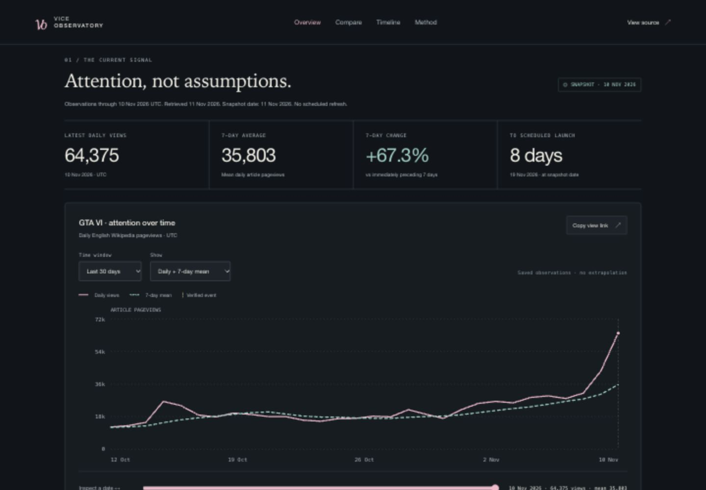

# Vice Observatory

An independent GTA VI launch-attention observatory, built from public Wikimedia pageviews and source-linked publisher announcements. No paid APIs or API keys.

**Status:** Phases 0–4 complete: reproducible data and analysis, a responsive dashboard, verified GitHub CI, and an isolated manual-refresh workflow. **1,649 actual daily observations**, **135 retrospectively scored predictions**, and **79 passing tests**. Production publication is Phase 5. Follow [phase checkpoints](docs/PHASES.md) for progress.

[](https://github.com/AnoopIbrampur/vice-observatory/actions/workflows/ci.yml)



## Open the dashboard locally

```sh
python3 -m http.server 8765 --bind 127.0.0.1 --directory dist
```

Open [http://127.0.0.1:8765/](http://127.0.0.1:8765/) in a modern browser. No build, npm install, API key, or paid service is needed. Serve over localhost or HTTPS; opening the HTML with `file://` is unsupported.

The interface includes time-window filters, daily/mean views, keyboard date inspection, raw/indexed launch comparisons, release selectors, a source-linked event timeline, data tables, shareable views, methodology, and downloads. See [Phase 3 verification](docs/PHASE_3.md) and [design decisions](docs/DESIGN.md).

## Reliability and operating workflows

GitHub CI actually passes on Python 3.11 and 3.13 with Node 22. It checks unit tests, source/analysis replay, all versioned downloads, static payload budgets, and loopback HTTP serving without requiring Wikimedia access. A separately tested manual workflow fetches a validated candidate artifact; it does not push or deploy automatically. See [Phase 4 evidence](docs/PHASE_4.md) and [workflow operations](docs/WORKFLOWS.md).

## The question

How does attention change around GTA VI announcements and launch, and how does its launch window compare with other major releases?

The measured signal is daily **English Wikipedia article pageviews**, not sales, unique people, sentiment, or active players. Event annotations describe timing; they do not establish causation. Future GTA VI launch outcomes remain unobserved.

## What is included

- An interactive attention explorer with daily values, trailing averages, verified event annotations, and accessible data tables.
- Release-aligned historical comparisons in raw and indexed units.
- Downloadable data, source provenance, freshness reporting, and reproducible analysis.
- An evaluation of simple past-only forecasting baselines, including failures.

See the [full project plan](PROJECT_PLAN.md), [source audit](docs/SOURCE_AUDIT.md), [data contract](docs/DATA_CONTRACT.md), and [Phase 1 verification report](docs/PHASE_1.md).

## Findings so far

- In the saved snapshot, GTA VI's article received **250,621 views during November 4–10, 2026**, versus 149,783 during the preceding seven days: **+67.3%**. This is article attention, not sales or unique people.
- A yesterday-only predictor has lower full-window MAE than a trailing-week mean in all three historical evaluation windows. The weekly mean does better in the three-day GTA V re-release regime; the [full findings report](docs/FINDINGS.md) includes that exception and all per-game scores.
- GTA VI's fixed normalization baseline has **20/21 observed dates** at this cutoff. Its indexed curve is unavailable until the baseline completes; launch-day and post-launch observations remain null.

Rules were fixed before computing results in the [analysis protocol](docs/ANALYSIS_PROTOCOL.md). See [Phase 2 verification](docs/PHASE_2.md). These historical scores are retrospective; no predictive claim about GTA VI launch outcomes is made.

## Run and reproduce

Requirements: **Python 3.11+** and **curl** on your PATH. No pip packages, API keys, account, or paid services are required. curl uses verified TLS and your system's certificate trust store.

```sh
git clone https://github.com/AnoopIbrampur/vice-observatory.git
cd vice-observatory

# Tests run without network access; test data is synthetic and clearly isolated.
python3 -m unittest discover -s tests -v

# Dashboard state and snapshot-integrity tests (Node 22+, no npm packages).
node --test tests/dashboard.test.mjs

# Verify the committed real-data snapshot without network access.
python3 -m scripts.pipeline verify

# Recompute and verify analysis from that exact snapshot, without network access.
python3 -m scripts.analysis build
python3 -m scripts.analysis verify

# Validate startup/download integrity and payload budgets without external APIs.
python3 -m scripts.check_release

# Exercise actual HTTP serving on a short-lived local loopback server.
python3 -m scripts.smoke_http

# Rebuild identical JSON/CSV from preserved responses into a separate directory.
python3 -m scripts.pipeline replay --output /tmp/vice-observatory-replay

# Optional: acquire a new snapshot using real network requests.
python3 -m scripts.pipeline refresh --as-of 2026-11-11
```

Without `--as-of`, refresh uses the current UTC date and requests only earlier days. A recent day may not yet be published by Wikimedia; incomplete source responses fail rather than filling gaps with zero. See [operations](docs/OPERATIONS.md) for failure recovery and refresh behavior.

## Inspect the data

[`data/current.json`](data/current.json) is the current version pointer. Its `dataset`, `csv`, `health`, and `manifest` fields resolve relative to `data/`. Each references an immutable snapshot directory. The dashboard loads browser-ready copies in `dist/data/` and `dist/analysis/` and verifies their hashes and matching source identities before display.

- `data/raw/`: exact Wikimedia response bytes, named by SHA-256.
- `data/receipts/`: request URLs, requested intervals, acquisition times, selected response headers, and payload checksums.
- `data/snapshots/`: versioned manifest, validated dataset, CSV, and coverage report.
- `config/`: explicit article identities, release dates, source evidence, and event status.
- `scripts/pipeline.py`: collection, validation, atomic publication, and offline replay.
- `tests/`: fault injection and end-to-end checks for provenance and safe publication.

[`analysis/current.json`](analysis/current.json) points to derived JSON, release-aligned CSV, per-day prediction CSV, the exact analysis protocol, and the findings report. Resolve its `files` paths relative to `analysis/`. Each analysis manifest records the source snapshot, protocol hash, and analysis-code hash; a source refresh makes previous analysis stale until rebuilt. Browser-ready copies live in `dist/analysis/`.

Initial snapshot: GTA VI from November 1, 2023 through November 10, 2026 (1,106 days), and 181-day historical windows for GTA V's 2022 console re-release, Red Dead Redemption 2, and Cyberpunk 2077. No GTA VI launch-day or post-launch observation is fabricated.

No scheduled refresh or automatic hosted-site deployment is enabled. The manual refresh workflow produces a candidate for review. Publishing a refreshed hosted application remains a separate verified deployment step.

## Sources and credit

Pageviews are provided by the [Wikimedia Analytics API](https://doc.wikimedia.org/generated-data-platform/aqs/analytics-api/), whose data is available under CC0 1.0. Code is MIT-licensed. Publisher announcements are linked as evidence; their text and artwork are not republished as project assets. This is an independent portfolio project by [Anoop Ibrampur](https://anoopibrampur.github.io/), unaffiliated with Rockstar Games, Take-Two Interactive, CD PROJEKT RED, or Wikimedia.
