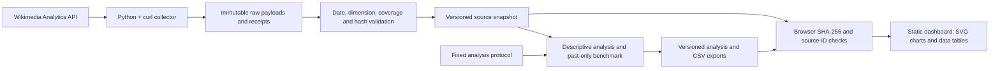
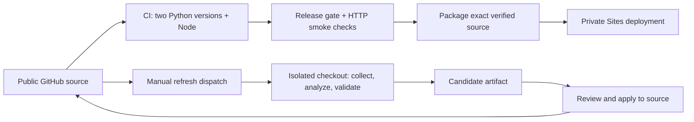

# Architecture

Current expansion: 20 series, 4,545 daily observations at the November 11 checkpoint, 855 fixed retrospective targets, 26 sourced events, 88 tests, title-audit evidence and daily GitHub Actions/Pages publication with explicit last-good retention. No paid API keys. See [expansion protocol](EXPANSION.md) and [operations](OPERATIONS.md). Earlier measurements below describe the initial release.

## Release and refresh

The review/apply and package/deploy arrows are explicit operations, not unattended hooks. CI does not deploy. Manual refresh does not commit. Source and derived data pointers must identify the same source version before the browser displays results.

## Boundaries

- No database, user account system, paid API, inference service, external font, or runtime chart dependency is needed.
- Collection alone uses an external API. A saved dashboard loads from same-origin static files.
- The source repository and Sites source repository are separate. The latter carries the deployment manifest; the portable public source omits Site identity and credentials.
- Source observations use UTC days. Acquisition time, analysis cutoff, and scheduled release dates are distinct fields.
- Raw and analysis snapshots are immutable; current pointers are replaced atomically per consumer. A source refresh requires analysis regeneration.
- The index is retrospective descriptive normalization. It is never a forecasting input.
