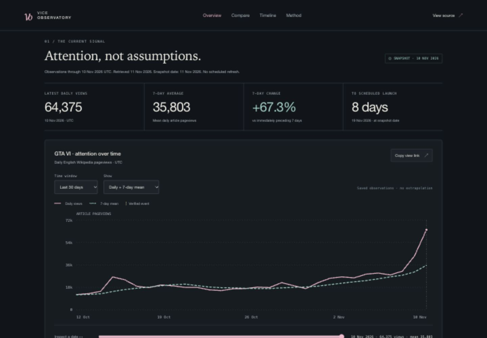

# Vice Observatory: the wait, in numbers

An independent, reproducible GTA VI launch-attention study. Project owner: Anoop Ibrampur. Implementation was AI-assisted with Codex; source code, tests, decisions, and verification evidence are public.

## The problem

Game-launch discussion produces confident claims about hype without a consistent definition of attention or a way to inspect the evidence. The goal was a useful, visually clear observatory that separates actual observations from speculation and makes its calculations reproducible. The project had to work without paid APIs, API keys, a hosted database, or manual gameplay labeling.

The question is deliberately narrow: **How does English Wikipedia article attention change around GTA VI announcements and release, and how does its release window compare with selected historical games?** It does not estimate sales, unique people, sentiment, or active players.

## The product

The dashboard combines an attention explorer, release-aligned comparison, source-linked timeline, underlying data tables, benchmark evidence, and CSV/JSON downloads. A visitor can change date ranges, inspect dates with a keyboard, filter original launches versus re-releases, and share the selected view through its URL.

The first saved snapshot, as of November 11, 2026, contains **1,649 real daily observations across four series**: GTA VI, GTA V's 2022 console re-release, Red Dead Redemption 2, and Cyberpunk 2077. GTA VI's observations stop on November 10; its November 19 release is still scheduled in this snapshot.

## Architecture

Public Wikimedia responses are collected sequentially with a descriptive User-Agent and bounded retry behavior. Raw bytes and acquisition receipts are preserved with SHA-256 identifiers. Validation requires the exact article, dimensions, and complete requested calendar interval. Missing observations are not converted to zero.

Analysis consumes the exact saved source version. It records its source ID, protocol hash, and implementation hash, then writes immutable derived JSON/CSV plus a human-readable report. Active pointers change only after valid files exist. The browser checks payload hashes and matching source/analysis IDs before rendering.

The application is buildless HTML/CSS/browser JavaScript with responsive SVG charts. Collection and analysis use Python's standard library and system curl. GitHub CI runs on Python 3.11 and 3.13 with Node 22; a separate manual workflow builds an isolated refresh candidate. The dashboard needs no third-party requests to load its saved observations.

See [architecture](ARCHITECTURE.md), [data contract](DATA_CONTRACT.md), and [operating workflow](WORKFLOWS.md).

## Decisions that mattered

**Choose a measurable signal.** Wikipedia pageviews were accessible without a key, had historical coverage, and could be preserved and replayed. The trade-off is limited interpretation: English-language exact-title traffic is not the whole audience. Earlier article titles and redirects are not merged.

**Compare like quantities, and label unlike releases.** Historical windows span days -90 through +90. Raw counts and within-title indices answer different questions. The index uses the fixed mean on days -28 through -8, inclusive. GTA V 2022 remains explicitly a console re-release. Its original 2013 launch predates the API's July 2015 coverage.

**Do not force an answer when data is unavailable.** At this cutoff, GTA VI's fixed normalizer has only 20 of its required 21 days. The indexed curve is unavailable; the baseline was not changed to manufacture a line. Its 99 future aligned dates contain nulls, not extrapolations. Raw observations remain available.

**Use a modest forecasting question.** The benchmark asks whether yesterday's count or the mean of the preceding seven calendar days better predicts the next day's views. Targets are fixed at release-relative days -14 through +30: 45 per historical game, 135 total. Both methods use identical targets and strictly earlier inputs. The protocol was committed before computing results, but the evaluation is retrospective, not an external preregistration or prospective record.

## Measured results

- GTA VI article views totaled **250,621 on November 4–10**, versus **149,783 in the preceding seven days**: **+67.3%**. This is an article-attention change, not evidence of a causal announcement effect or sales growth.
- Yesterday-only prediction has lower full-window MAE in all three historical windows. Equal-game macro WAPE is **17.0%** for yesterday versus **32.4%** for the trailing-week mean. These are error ratios, not accuracy percentages.
- The weekly mean does better in GTA V's three-day re-release regime. The report includes that exception and separate pre-launch, launch-days, and post-launch scores.
- **79 unit tests pass**, plus deterministic replay, release-gate, and HTTP smoke checks. Real GitHub CI passed both supported Python versions.
- Startup assets and saved JSON total **559,978 raw bytes** in the measured release. Estimated gzip transfer is about **69 KB**; no compression or Lighthouse score is claimed for the eventual host.

See [full findings](FINDINGS.md) and [Phase 4 verification](PHASE_4.md) for exact windows, scores, and run links.

## A failure that improved the project

Local analysis replay worked on Python 3.13, but the first CI matrix failed on 3.11. A change in Python's floating-point `sum` accumulation produced tiny error-total differences and broke byte-identical reproduction. Replacing floating accumulation with `math.fsum`, while preserving exact integer totals, fixed both environments. The human-readable findings stayed byte-identical. Previous snapshots were preserved rather than rewritten.

This was a useful distinction between a calculation that appears correct and one that is demonstrably reproducible across supported environments.

## Reliability and interaction

Fault-injection browser checks confirmed that an HTTP outage, changed payload, or stale source/analysis association withholds the dashboard and shows an explicit error. A retry preserves that behavior; a valid snapshot restores the charts. Tests verify missing dates, zero denominators, future-data exclusion, path safety, and earlier predictions remaining unchanged when future outcomes are mutated.

Keyboard inspection and expandable tables provide an alternative to chart clicks. Series use patterns as well as colors. Desktop and mobile layouts were inspected; control borders were strengthened after contrast measurement. Reduced-motion CSS is present and parsed by the browser. No comprehensive screen-reader or accessibility-conformance claim is made.

## Delivery and limits

The repository and [live dashboard](https://vice-observatory-anoop.poeticskink11.chatgpt.site) are public, and the static build is portable. The initial owner-only review deployment was opened to the public at the owner's explicit request. A manual refresh artifact is not a push or deployment, and no scheduled update is active.

Three selected historical windows do not establish generalization across game launches. Calendar-aligned event changes do not establish causation. No trained ML model, GTA VI launch forecast, or proprietary telemetry is claimed. Useful next steps are title-history reconciliation, more comparison releases under fixed rules, and a verified publication path for refreshes.
